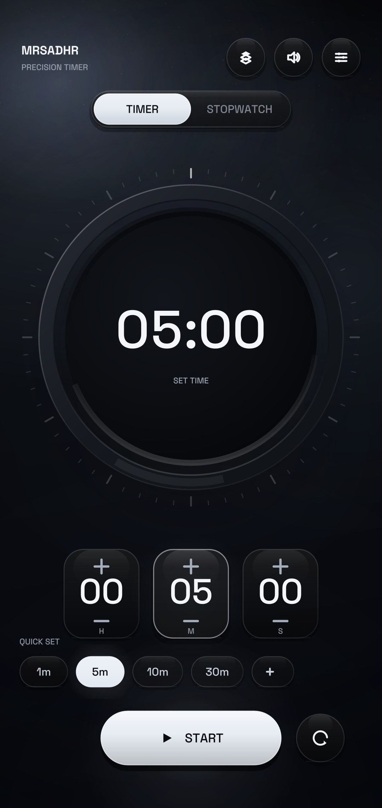
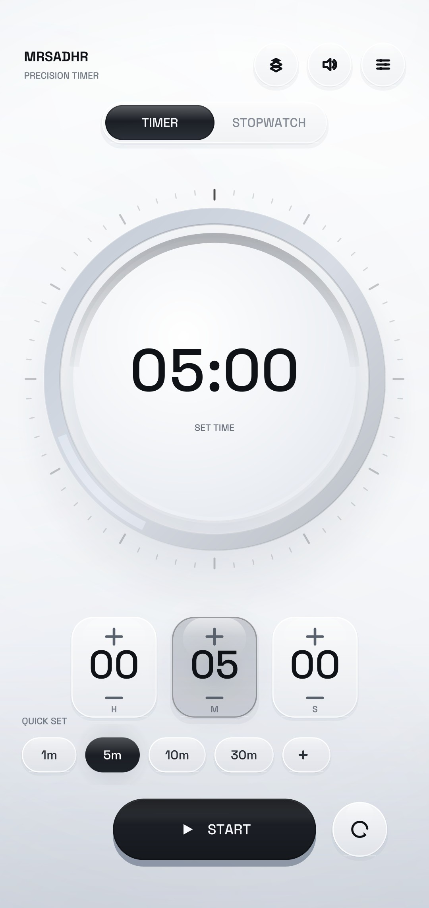
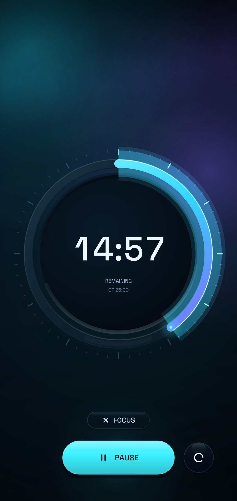
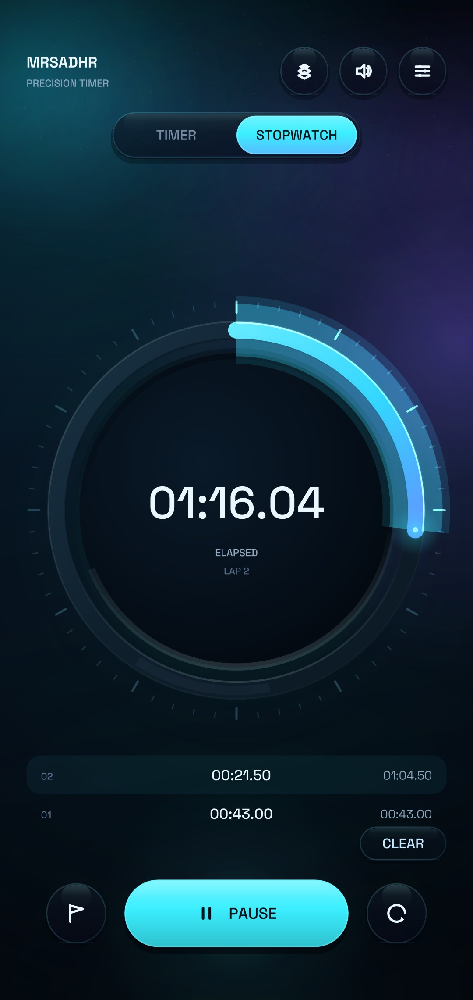
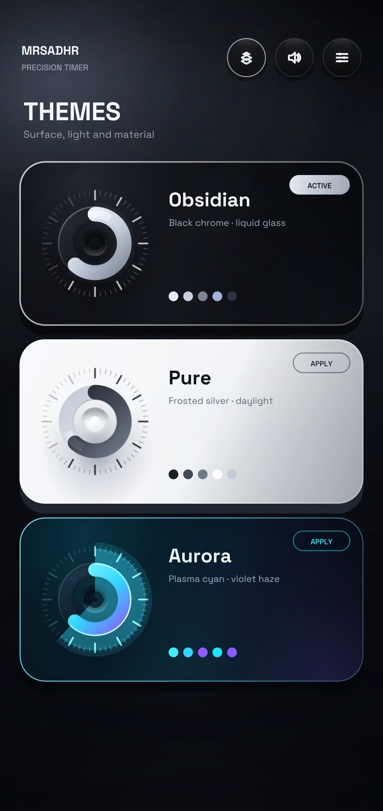
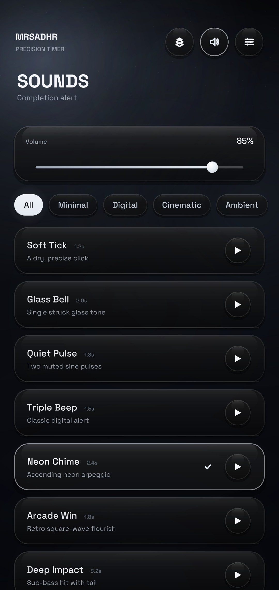
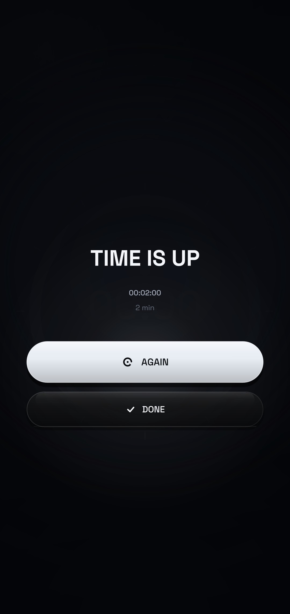
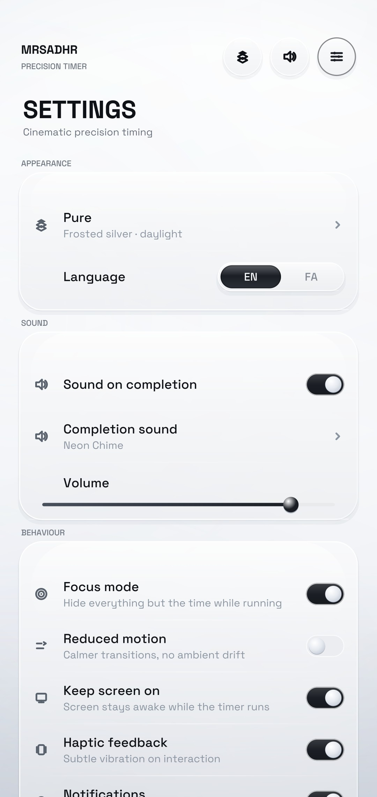
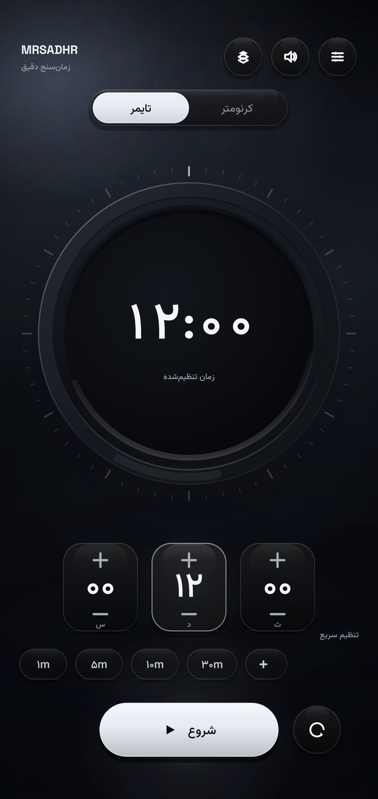
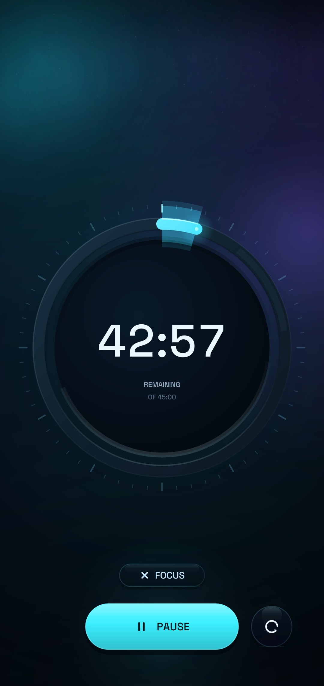

# MrsadHR — Precision Timer

A complete, installable Android timer: three full themes, a three-dimensional progress ring,
monotonic timing that survives screen-off and process death, a stopwatch with laps, a sound
library of twelve original clips, English and Persian, and a small motion system that keeps the
interface calm.

Everything in this repository is the real application — there are no mockups, no dead buttons and
no placeholder screens.



| Pure | Aurora | Stopwatch |
| --- | --- | --- |
|  |  |  |

| Themes centre | Sounds centre | Completion |
| --- | --- | --- |
|  |  |  |

| Settings | Persian | Focus mode |
| --- | --- | --- |
|  |  |  |

The previews above are produced by the same screen code that runs on the phone, rendered off-device
through the second `Painter` implementation (see *Architecture*).

---

## Install

The signed debug build is committed at **`dist/mrsadhr-debug.apk`** (3.3 MB, `versionCode 2`,
`versionName 1.0.1`, `minSdk 23` — Android 6.0 and newer — `targetSdk 35`, package `com.mrsadhr`).

```bash
adb install -r dist/mrsadhr-debug.apk
```

It is signed with the standard Android debug key, so it installs on any device with
"install unknown apps" enabled. Release builds use your own key — see *Building*.

### When a sideloaded copy refuses to install or closes at once

There is no store console for a self-installed APK, so the app reports its own failures:

* **It will not install.** Android hides the reason behind "App not installed". Run
  `adb logcat -s PackageManager PackageInstaller` while retrying, or on a phone open
  *Settings → Apps → Special access → Install unknown apps* and allow the browser or file
  manager that holds the download. A "package appears to be invalid" error means the download was
  truncated — compare the SHA-256 below.
* **It closes immediately.** `1.0.1` wraps startup and the draw loop in `CrashGuard`
  (`app/src/main/java/com/mrsadhr/android/CrashGuard.kt`): a startup failure becomes a selectable
  text screen, and a failure after the first frame is written to `filesDir/last_crash.txt` and shown
  as a copyable dialog on the next launch. Copy that text to report a problem. For a hard failure
  before any UI exists, `adb logcat -s AndroidRuntime` still prints the stack trace.

SHA-256 of the shipped file:

```
4ad9c68572dd3875b0d1e84fe00d1207876ee98bcf36306e36d55df64f2ab2c3
```

## Build

### Android Studio / Gradle (the normal path)

```bash
cd MrsadHR
./gradlew assembleDebug        # or open the folder in Android Studio and press Run
```

Requires JDK 17 and Android SDK 35. The Gradle wrapper *properties* are committed but the wrapper
JAR is not (binary); a fresh checkout creates it once with `gradle wrapper`, or by opening the
project in Android Studio, which downloads the distribution itself.

The project has **no third-party runtime dependencies** — no AndroidX, no Compose, no
retrofit-style graph. `app/build.gradle.kts` declares an empty `dependencies` block on purpose.

### Command line, without Gradle

`tools/apk/build_apk.sh` is the exact toolchain that produced `dist/mrsadhr-debug.apk`: `aapt2`
compiles and links the resources, `kotlinc` compiles the Kotlin sources, `d8` produces the dex,
`zipalign` re-packs the assets and `apksigner` signs and verifies the result.

```bash
tools/apk/build_apk.sh debug dist/mrsadhr-debug.apk
```

It needs a JDK, `kotlinc`, Android build-tools 35 (`aapt2`, `d8`, `apksigner`) and the Android
platform jar; the paths default to the ones used here and every one of them can be overridden with
an environment variable (`JAVA_HOME`, `KOTLINC`, `AAPT2`, `ANDROID_JAR`, `MINAPK`, …).

## Tests

```bash
# 55 tests: engines, controller, formatting, audio assets, interaction, rendering
tools/test/run_tests.sh
```

`run_tests.sh` compiles the app sources plus the harness and runs the suite; it exits non-zero on
any failure. What it covers:

* **Countdown engine** — monotonic countdown, pause/resume/reset, zero-length timers, expiry at
  exactly zero, restart after completion, duration clamping, restore on the same boot, restore
  after a reboot (wall-clock fallback), restore of a paused timer, expired restore never yielding
  negative time.
* **Stopwatch engine** — millisecond accuracy, pause accumulation, laps (index/total/split), reset,
  restore that keeps counting through the gap.
* **Controller** — start/pause/reset through the platform bridge, completion fired exactly once,
  repeat/dismiss, stepper carry and clamping, preset save/delete/cap, settings persistence across a
  restart, running-timer restore, completion restore, stopwatch actions, sound preview expiry,
  haptics respecting the setting, observer subscription, no redundant settings writes.
* **Formatting** — `h:mm:ss`, always-padded `hh:mm:ss`, stopwatch centiseconds, preset labels,
  Persian digit localisation.
* **Audio** — every catalog entry ships an asset of the advertised length, peak and RMS; the WAV
  decoder handles mono, stereo downmix and rejects junk.
* **Interaction** — synthetic touches against the production `Stage`: primary button, reset,
  steppers, presets, mode switch, header navigation, theme selection (and its persistence), sound
  preview and selection, language/focus/reduced-motion toggles, focus mode visibility, completion
  overlay actions, scrolling on a short screen.
* **Rendering** — each theme paints a distinct surface, the ring changes while running, and Persian
  text produces different glyphs than Latin.

These are real assertions on real code paths, not smoke tests: writing them found and fixed three
production bugs (hit-test ordering that made whole screens untappable, a scroll maximum that
collapsed as you scrolled, and drag gestures that lost their origin).

## What the app does

**Timer.** A 0–99 h dial with an h/m/s stepper, four built-in presets plus up to eight saved
custom presets, and start/pause/resume/reset. Progress is derived from the monotonic clock
(`SystemClock.elapsedRealtime()`), never from frame counts, so a dropped frame, a doze window or a
long GC pause cannot make the countdown drift. Duration, remaining time, deadline, run state and
completion are persisted on every transition and on pause, so a process kill — or a reboot, where
the monotonic clock resets and the wall clock is used instead — restores exactly the right state.

**Foreground service.** While a timer runs, a foreground service keeps the process alive and shows
a notification with a *system count-down chronometer*, which the platform animates without the app
waking up: exact to the second, free in battery. The service schedules a single wake-up at the
deadline to fire the completion alert. Notification actions pause and reset the timer. No
`SCHEDULE_EXACT_ALARM` permission is requested or needed, and no wake lock is held while idle.

**Stopwatch.** The same monotonic authority, with centiseconds, laps (total and split), and a
restore that keeps counting through the time the app was not running.

**Themes.** Obsidian (black chrome, silver progress), Pure (frosted daylight, graphite) and Aurora
(cyan→violet plasma). Each has its own backdrop painting, ring material, glass, chips, typography
contrast and motion feel; switching themes cross-fades the whole token set, so nothing snaps. The
choice persists, and the Themes centre previews each one live with a real miniature ring.

**Sounds.** Twelve original clips in four families (Minimal, Digital, Cinematic, Ambient), each
generated from scratch by `tools/gen/sounds.py` — no sampled or third-party audio. Play/stop
preview per row, a volume slider, a master switch, and persistence of the chosen clip.

**Settings.** Language (English/Persian, full RTL), theme, sound, volume, focus mode, reduced
motion, keep-screen-on, haptics, notifications, and an about block. Persian uses Vazirmatn for the
UI and Space Grotesk for the brand mark; digits, durations and labels are localised, and mirrored
layouts follow the language.

**Focus mode.** Starting a countdown fades the header, steppers and presets away and leaves the
instrument, the transport and a small exit pill; pausing or finishing fades them back.

## Architecture

```
app/src/main/java/com/mrsadhr/
  core/           render (Painter contract, geometry, ARGB), motion (durations, easing, Animated),
                  time (TimeSource), model, formatting, feature flags
  themes/         three palettes + ring styles, and the lerp between them
  timer/          CountdownEngine      — monotonic deadline maths, persistence, restore
  stopwatch/      StopwatchEngine      — start stamp + accumulated time, laps
  data/           KeyValueStore contract, in-memory implementation
  platform/       PlatformBridge + SoundEngine contracts, no-op implementations
  sounds/         catalog of the twelve clips, WAV decoder
  app/            Action (user intent), AppController (the single source of truth)
  ui/             Design (tokens + paints), Stage (theme blend, router, header, touch),
                  Lang (EN/FA strings), art/ (surfaces, backdrops, ring), widget/ (controls, icons),
                  screen/ (timer, themes, sounds, settings, completion overlay)
  android/        AndroidPainter, font loader, SharedPreferences store, SoundPool-free AudioTrack
                  engine, haptics, notifications, foreground service, view, activity
tools/harness/    desktop Painter + font loader, preview renderer, test suite
tools/gen/        the sound design generator
tools/apk/        the Gradle-free build
```

**Layering.** `AppController` owns the engines, settings and completion state; screens are pure
`layout()`/`draw()` functions over an immutable state snapshot that are handed a `Painter`. No
screen touches a platform API, and no business rule lives in a drawing function. The controller has
no Android imports at all.

**One renderer, three surfaces.** The entire UI is written against a small `Painter` interface
(rects, paths, arcs, gradients, text, layer alpha, blend modes). Three implementations exist: the
device's `Canvas`, the desktop preview renderer, and nothing else — which is why the README's
screenshots and the interaction tests exercise the same code as the phone.

**Animation.** `Motion` defines the timing vocabulary (120–180 ms press, 180–250 ms chips,
300–400 ms screens, 450–650 ms theme, 900–1400 ms completion) and `Animated`/`Smoothed` implement
explicit-time interpolation, so every animation is frame-rate independent and testable with a
manual clock. Reduced motion snaps instead of travelling.

**Frame loop.** The view requests frames from the Choreographer only while something moves: a
running timer, a transition, a pressed control. When the interface is idle it parks and wakes twice
a second, so a timer sitting on screen costs almost nothing.

## Design tokens

| | Obsidian | Pure | Aurora |
| --- | --- | --- | --- |
| Backdrop | near-black glass | frosted light | deep navy plasma |
| Progress | silver → chrome | graphite | cyan → violet |
| Accent | white | ink | neon cyan |
| Glass | dark glass + hairline | white card + soft shadow | tinted glass with glow |

Type scale: Space Grotesk (400/500/700) for Latin, Vazirmatn (400/500/700) for Persian; tabular
figures with tight tracking for the readout, wide-tracked micro labels for captions. Spacing follows
a 4 dp rhythm; radii 12/16/24/28 dp; shadows are soft, tinted and never outline-based.

## Deliberate deviations, stated plainly

* **No Jetpack Compose / Material 3 / Room / DataStore / Lottie.** Every Maven and Google Maven
  host was unreachable from the build environment, so the Compose runtime could not be resolved.
  Rather than ship a fake or an unbuildable project, the UI layer is a purpose-built render core
  over `android.graphics.Canvas` that keeps the requested architecture (design tokens, immutable
  state, MVVM-style controller, coroutine-free explicit-time animation) and the requested visual
  result. Persistence uses SharedPreferences behind a `KeyValueStore` interface (a Room or DataStore
  implementation can be swapped in without touching the controller); the completion animation is a
  hand-written cinematic sequence rather than a Lottie file; the "MOTION ENGINE M1" timings are
  implemented in `core/motion/Motion.kt`.
* **Kotlin/Flow.** The state is exposed as an immutable snapshot plus a listener rather than a
  `StateFlow`, because the render loop consumes it synchronously every frame; the same immutability
  guarantee holds.
* **Instrumented tests.** Espresso/Compose UI tests need the AndroidX test artifacts, which were
  also unreachable. The interaction tests instead drive the production `Stage` with synthetic touch
  events and assert on the resulting state and pixels — the same code paths, minus the emulator.
  Nothing on the device-only surface (notification rendering, vibration, audio output) could be
  executed here, and no claim is made that it was.
* **Release minification.** `app/build.gradle.kts` configures a release build with R8 shrinking and
  the default optimisation file, but that build was not executed in this environment; the shipped
  APK is the debug variant produced by `tools/apk/build_apk.sh` and verified with `apksigner`.

## Verification performed here

* `tools/apk/build_apk.sh` completes: `aapt2` link, `kotlinc` compile, `d8`, zipalign, signing.
* `apksigner verify --print-certs dist/mrsadhr-debug.apk` — v1/v2/v3 signatures valid.
* `aapt2 dump badging` — `com.mrsadhr`, versionCode 2, versionName 1.0.1, minSdk 23, targetSdk 35.
* APK contents inspected: `classes.dex`, six font files, twelve WAV assets, resources, five raster
  launcher icons (`mipmap-mdpi` 48 px … `mipmap-xxxhdpi` 192 px) plus the API 26+ adaptive icon, no
  missing references.
* `apksigner verify --min-sdk-version 23` — v1 (JAR), v2 and v3 signatures all valid, so the same
  file installs on Android 6 through 15.
* 55/55 tests pass on the JVM.
* Eleven preview frames rendered from the production `Stage` at 1080×2280 @ 2.75x.

Not verified here: behaviour on a physical device or emulator (notification appearance, haptics,
audio output, system bar insets, cold-start time) and the Gradle build itself.

## License notes

Space Grotesk (SIL Open Font License 1.1), Vazirmatn (SIL Open Font License 1.1). All sound assets
are generated by `tools/gen/sounds.py` in this repository and are original works.

## Accessibility and small screens

Text sizes follow the system font scale through `Design.textSize`, clamped to 0.85–1.30 so the
dense instrument layout cannot break at 200%; the readout measures itself and shrinks to fit its
disc. Every surface is laid out from a density-scaled viewport with safe-area insets, the settings,
sounds and themes lists scroll on short screens (tested at 1080×1500), and reduced motion converts
every transition into a snap.
